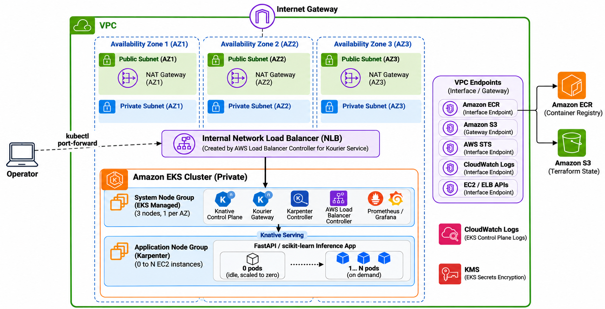
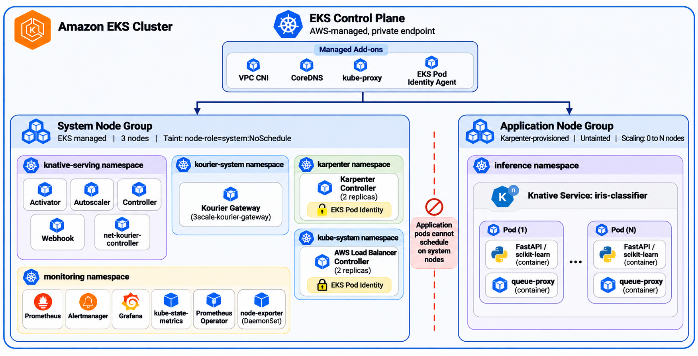
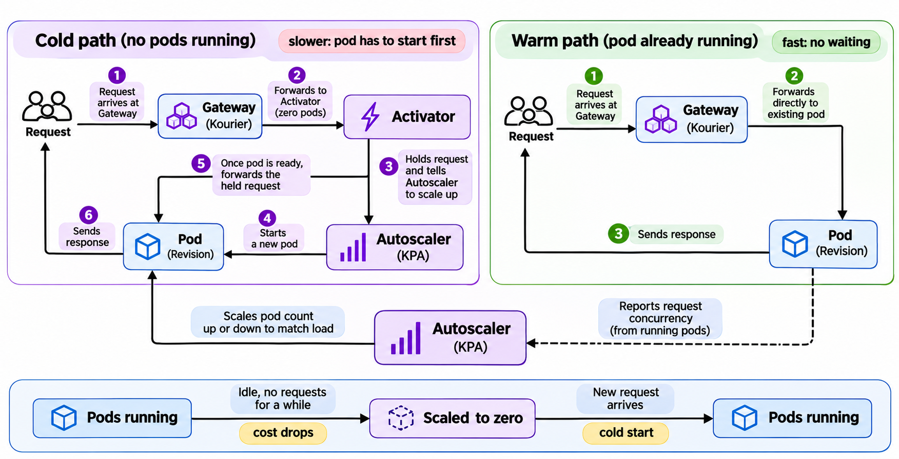

# knative-serving-demo

A FastAPI app serving real AI model inference (a scikit-learn classifier),
run on Knative Serving on a production-grade Amazon EKS cluster, scaling
from zero to demand. When traffic stops, it scales back down to zero.

## Architecture

### Multi-AZ VPC and EKS architecture



### EKS cluster components



### Knative Serving request paths



System nodes carry a `node-role=system:NoSchedule` taint, so app pods only
run on Karpenter-provisioned nodes. Karpenter itself runs on the system pool.

## Repository layout

```
terraform/          AWS infrastructure (VPC, EKS, IAM, Karpenter, AWS LB Controller)
app/                 FastAPI inference service (Dockerfile, tests)
k8s_manifests/       Namespace, NetworkPolicy, Knative Service profiles, ServiceMonitor
monitoring/          kube-prometheus-stack Helm values + the demo Grafana dashboard
scripts/             One step per file: provision, configure, build, install, deploy, demo, destroy
```

## Prerequisites

- Terraform >= 1.9, AWS CLI v2, kubectl, helm, docker
- An AWS account with permission to create the resources below
- An S3 bucket for Terraform state (see below)

## Bootstrap the state backend

```bash
aws s3api create-bucket --bucket <your-state-bucket> --region <your-region> \
  --create-bucket-configuration LocationConstraint=<your-region>
aws s3api put-bucket-versioning --bucket <your-state-bucket> \
  --versioning-configuration Status=Enabled
aws s3api put-bucket-encryption --bucket <your-state-bucket> \
  --server-side-encryption-configuration '{"Rules":[{"ApplyServerSideEncryptionByDefault":{"SSEAlgorithm":"aws:kms"}}]}'
aws s3api put-public-access-block --bucket <your-state-bucket> \
  --public-access-block-configuration BlockPublicAcls=true,IgnorePublicAcls=true,BlockPublicPolicy=true,RestrictPublicBuckets=true
```

Terraform >= 1.10 can lock state natively (`use_lockfile=true`). Older
versions need a DynamoDB table passed as `TF_LOCK_TABLE`.

## Deployment workflow

```bash
cp terraform/terraform.tfvars.example terraform/terraform.tfvars   # fill in your values

export TF_STATE_BUCKET=<your-state-bucket>
export TF_STATE_REGION=<your-region>

scripts/01-provision-infra.sh                  # VPC, EKS, Karpenter, LB controller IAM
scripts/02-configure-kubectl.sh                # point kubectl at the new cluster
scripts/03-build-push-image.sh                 # build + push the app image to ECR
scripts/04-install-knative-and-monitoring.sh   # Knative, Kourier, Prometheus, Grafana
scripts/05-deploy-app.sh demo                   # or: scripts/05-deploy-app.sh production
scripts/06-demo-scale-to-zero.sh                # the actual demo
scripts/07-view-dashboards.sh                   # Grafana, port-forwarded

scripts/destroy.sh                              # tear down everything when done
```

## Accessing the private API endpoint

`enable_public_eks_access` defaults to `false`. Reach the private endpoint
via a VPN, or an SSM-managed bastion with `aws ssm start-session` port
forwarding. Otherwise set `enable_public_eks_access = true` and scope
`public_access_cidrs` to your own IP.

## Workload profiles

- **`knative-service-demo.yaml`**: `minScale: 0`, shows scale-to-zero and
  cold start.
- **`knative-service-production.yaml`**: `minScale: 2`, higher resources.
  Tune `min-scale`/`target` for your own latency and availability needs.

### Cold start: two different experiences

- Warm application node already exists: ~4s (pod scheduling + readiness).
- No application node, Karpenter launches a new EC2 instance: node
  launch-to-`Initialized` alone measured ~31s. `timeoutSeconds` in the demo
  profile is 60 (not Knative's default 30) to absorb this live on stage,
  though that's still not a hard guarantee since EC2 launch time varies.

Removing a pod (scale-to-zero) and terminating a node are different things.
Cost savings only happen once the node goes away too, and that's also what
makes the next cold start slow. Workloads that can't tolerate an occasional
slow first request should use the production profile with `minScale >= 1`.

## Validation

```bash
terraform -chdir=terraform fmt -check -recursive
terraform -chdir=terraform init -backend=false && terraform -chdir=terraform validate
tflint --chdir=terraform                       # if installed
trivy config terraform/ k8s_manifests/ app/Dockerfile
python3 -m venv app/.venv && app/.venv/bin/pip install -r app/requirements-dev.txt
app/.venv/bin/python -m pytest app/tests/ -v
trivy image <your-ecr-image-uri>                # after scripts/03-build-push-image.sh
```

All of the above pass against this repo. `terraform apply` has also been run
for real against a live cluster, with the full app pipeline deployed and
verified: `/predict` returns correct predictions, scale-to-zero and cold
start both confirmed, burst load scales out correctly.

### Verifying specific properties

- **High availability**: `kubectl get nodes -L topology.kubernetes.io/zone`
  across all three AZs. Cordon a system node and confirm pods reschedule.
- **IAM permissions**: `aws eks list-access-entries --cluster-name <name>`.
  Check a pod's Pod Identity association rather than assuming it's attached.
- **Private networking**: `aws eks describe-cluster` should show the public
  endpoint disabled/CIDR-restricted.
- **Node recovery**: delete a system node or an app pod and watch it get
  replaced.
- **Autoscaling**: `scripts/06-demo-scale-to-zero.sh` exercises both the
  Knative autoscaler and Karpenter in one pass. Watch both in Grafana.

## Cost and what scale-to-zero actually saves

Removing an idle pod frees capacity on a node that's still running and still
billing. Cost only drops once Karpenter also removes that node. The system
node group never scales to zero, so that's the floor cost of this setup.

To measure rather than assume:

- Pod resource usage: `kubectl describe pod` in `inference`, or the CPU/memory
  panels in the demo dashboard.
- Karpenter node count: the "Karpenter application nodes" panel, or
  `kubectl get nodes -l node-role=application`.
- Cold-start latency: timed directly by `scripts/06-demo-scale-to-zero.sh`.
- AWS cost: tag-filtered Cost Explorer on `Project=<cluster_name>`, or
  `infracost breakdown --path terraform/`.

We don't report carbon savings here. That would need real grid
carbon-intensity data, which this project doesn't collect.

## Cleaning up

`scripts/destroy.sh` removes the app, Knative/Kourier, monitoring, then runs
`terraform destroy`. The ECR repository and the Terraform state bucket were
created out of band, so they survive `destroy.sh`. Remove them separately
if you're fully done.
